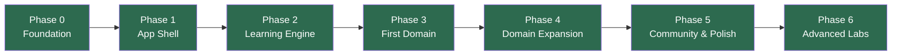

# OPENLAB Roadmap

Phased, incremental delivery. Each phase ends with a working, deployable state.
Dates are intentionally absent: this is a volunteer, zero-budget project. Order matters; time does not.

## Phase 0 — Foundation ✅ (complete)

- [x] Environment discovery and report
- [x] Architecture documentation and ADRs
- [x] Project, Git and GitHub preparation
- [x] Tooling configuration (Vite, TS, ESLint, Prettier, Vitest, Playwright)
- [x] CI/CD workflow definitions (not yet executed)
- [x] First commit (`004a900`, 2026-11-15)
- [ ] Push to GitHub (awaiting repository creation)

## Phase 1 — Application Shell ✅ (built 2026-11-15, deployment pending push)

Goal: an empty but deployed site with navigation, theming and routing.

- [x] `index.html`, `src/app/main.tsx`, `App.tsx`, `HashRouter` setup
- [x] Layout: header, nav, content area, footer, skip link
- [x] Design tokens (`src/styles/tokens.css`), light/dark/system theme, reduced-motion support
- [x] Home page (domain catalogue, driven by `src/data/domains.ts`)
- [x] Domain placeholder page (`#/domains/:id`)
- [x] 404 route
- [x] Error boundary
- [x] Preferences persisted through `src/core` (safe localStorage wrapper)
- [x] Production-only Content Security Policy injection
- [x] Unit, component, Playwright smoke and axe accessibility tests (light + dark)
- [ ] First successful GitHub Pages deployment (needs repository + push)

## Phase 2 — Learning Engine (`src/core`) ✅ (built 2026-11-15)

Goal: the reusable machinery every domain plugs into.

- [x] `DomainModule` / `Lesson` / `Lab` / `Simulator` type model (ADR-0008)
- [x] Module registry: id/slug validation, cross-reference checks, prerequisite DAG with cycle detection, route generation
- [x] Progress store (localStorage, versioned strict schema, debounced persistence, export/import JSON with merge or replace)
- [x] Lesson renderer (paragraphs with code spans, headings, lists, callouts, code blocks, embedded simulators, quizzes)
- [x] Simulator host (play / pause / step / reset / speed, throttled live region, no autoplay, reduced-motion aware)
- [x] `SvgStage` visualisation primitive and `useAnimationFrame`
- [x] Client-side search across lessons and labs
- [x] Pages: domain (lesson/lab lists with completion), lesson, lab (live check), search, progress (export/import/reset)
- [ ] Canvas stage and timeline primitives (deferred until a simulator needs them)

## Phase 3 — First Domain: Networking ✅ (built 2026-11-15)

Goal: prove the engine with one complete domain.

- [x] OSI & TCP/IP layer explorer (lesson + interactive simulator + quiz)
- [x] Packet journey / encapsulation simulator
- [x] IP addressing & subnetting lesson with subnet planner and quiz
- [x] Subnet sizing lab (graded: too small / wasteful / tight)
- [x] DNS resolution walkthrough (sequence-diagram simulator)
- [x] TCP three-way handshake (step or hand-drive; out-of-order attempts counted) + lab
- [x] TLS 1.3 handshake walkthrough
- [x] Per-domain lazy loading (ADR-0009, 2026-11-16)

## Phase 4 — Domain Expansion ✅ (complete 2026-11-16)

One domain at a time, each with ≥ 3 lessons, ≥ 1 simulator, ≥ 1 lab.

1. ~~Linux & OS~~ ✅ 2026-11-15 — sandbox shell on an immutable virtual filesystem, permission bits, round-robin scheduler, FIFO/LRU paging; 5 lessons, 2 labs
2. ~~Programming~~ ✅ 2026-11-15 — code tracer (incl. a buggy variant), stack/queue, sorting visualiser, binary search; 5 lessons, 2 labs
3. ~~Computer Science~~ ✅ 2026-11-16 — 8-bit register, logic gates, 4-bit ripple-carry adder, tiny accumulator CPU, divisible-by-3 DFA; 5 lessons, 2 labs
4. ~~Cybersecurity~~ ✅ 2026-11-16 — Caesar brute force, password entropy, salted/unsalted dictionary attack on real SHA-256, SQL injection against a tiny SQL interpreter, simulated XSS; 5 lessons, 2 labs
5. ~~System Design~~ ✅ 2026-11-16 — load balancer with a slow server, LRU cache under Zipf traffic, message queue with Little’s law, replication quorum; 4 lessons, 2 labs
6. ~~Cloud & DevOps~~ ✅ 2026-11-16 — commit graph, CI/CD job graph, Docker layer cache, error budget; 4 lessons, 3 labs
7. ~~AI & ML~~ ✅ 2026-11-16 — perceptron (incl. XOR), gradient descent on an ill-conditioned bowl, BPE tokenizer, softmax temperature sampling; 4 lessons, 2 labs. Attention/transformers deferred: see Phase 6

## Phase 5 — Community & Polish ✅ (complete 2026-11-16)

- [x] Content authoring guide and lesson/simulator generators (`npm run new:lesson`, `npm run new:simulator`)
- [x] i18n foundation for UI text (ADR-0010); content translation still to come
- [x] Offline support via a build-generated service worker and web app manifest (ADR-0011)
- [x] Performance budget enforced in CI (`npm run budget`)
- [x] Contributor onboarding: ten ready-to-file starter issues (`docs/contribution/GOOD_FIRST_ISSUES.md`)

## Phase 6 — Advanced Labs ✅ (complete 2026-11-16)

- [x] Learning paths spanning domains: `#/paths`, built from the prerequisite graph
- [x] Shareable lab state via URL hash encoding: replayable action logs (ADR-0013)
- [x] WebAssembly: evaluated and **deferred** with benchmark evidence (ADR-0012); revisit criteria recorded

## Explicit non-goals

- User accounts, social features, leaderboards
- Server-side anything
- Paid tiers, ads, sponsorship banners in the app
- Analytics or telemetry of any kind
