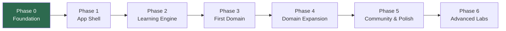

# OPENLAB Roadmap

Phased, incremental delivery. Each phase ends with a working, deployable state.
Dates are intentionally absent: this is a volunteer, zero-budget project. Order matters; time does not.

## Phase 0 — Foundation ✅ (complete)

- [x] Environment discovery and report
- [x] Architecture documentation and ADRs
- [x] Project, Git and GitHub preparation
- [x] Tooling configuration (Vite, TS, ESLint, Prettier, Vitest, Playwright)
- [x] CI/CD workflow definitions (not yet executed)
- [ ] First commit and push (awaiting approval)

## Phase 1 — Application Shell

Goal: an empty but deployed site with navigation, theming and routing.

- `index.html`, `src/app/main.tsx`, `App.tsx`, `HashRouter` setup
- Layout: header, sidebar/nav, content area, footer
- Design tokens (`src/styles/tokens.css`), light/dark theme, reduced-motion support
- Home page (domain catalogue, driven by `src/data`)
- 404 route
- Error boundary
- First Playwright smoke test + axe audit
- First successful GitHub Pages deployment

## Phase 2 — Learning Engine (`src/core`)

Goal: the reusable machinery every domain plugs into.

- `DomainModule` / `Lesson` / `Lab` / `Simulator` type model
- Module registry and route generation
- Progress store (localStorage, versioned schema, export/import JSON)
- Lesson renderer (sections, callouts, code blocks, quizzes)
- Simulator host component (play / pause / step / reset / speed)
- Shared visualisation primitives (SVG canvas, Canvas hook, timeline)
- Search across lessons (client-side index)

## Phase 3 — First Domain: Networking

Goal: prove the engine with one complete domain.

- OSI & TCP/IP layer explorer
- Packet journey simulator (encapsulation, routing)
- Subnet calculator lab
- DNS resolution walkthrough
- TCP handshake and TLS handshake animations

## Phase 4 — Domain Expansion

One domain at a time, each with ≥ 3 lessons, ≥ 1 simulator, ≥ 1 lab.

1. Linux & OS (terminal simulator, filesystem explorer, process scheduler)
2. Programming (algorithm visualiser, data structure playground)
3. Computer Science (logic gate simulator, CPU pipeline)
4. Cybersecurity (crypto playground, auth flow walkthroughs, sandboxed vuln demos)
5. System Design (load balancer / cache / queue simulators)
6. Cloud & DevOps (pipeline builder, container lifecycle)
7. AI & ML (perceptron, gradient descent, attention visualiser)

## Phase 5 — Community & Polish

- Content authoring guide and lesson template generator script
- i18n foundation
- PWA (offline support via service worker — still static, still free)
- Performance budget enforcement in CI
- Contributor onboarding issues

## Phase 6 — Advanced Labs

- WebAssembly-powered simulators where JS is too slow
- Shareable lab state via URL hash encoding
- Learning paths spanning domains (uses the knowledge graph)

## Explicit non-goals

- User accounts, social features, leaderboards
- Server-side anything
- Paid tiers, ads, sponsorship banners in the app
- Analytics or telemetry of any kind
