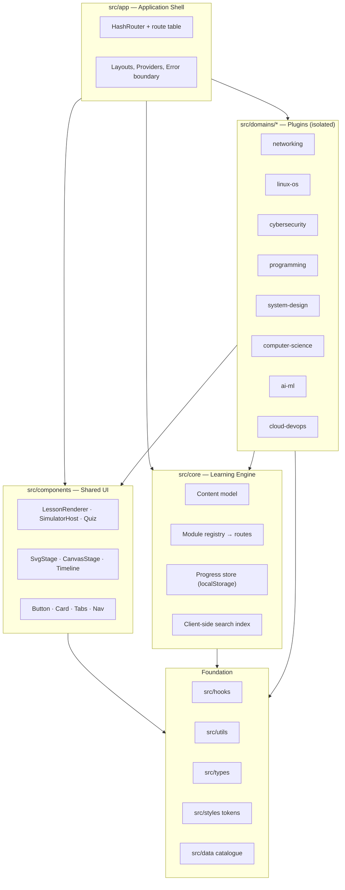

# OPENLAB Architecture Overview

## Vision

A **static-first, client-side, zero-cost** learning platform. The entire product is a folder
of HTML, JS, CSS and assets that any static host can serve. The browser does all the work:
routing, rendering, simulation, persistence and search.

## Guiding constraints

| #   | Constraint              | Consequence                                                 |
| --- | ----------------------- | ----------------------------------------------------------- |
| 1   | Static-first            | Build output is pure files; no SSR, no serverless functions |
| 2   | Client-side processing  | Simulators, quizzes, search and progress run in the browser |
| 3   | No mandatory backend    | Nothing breaks if GitHub Pages is the only infrastructure   |
| 4   | No paid APIs            | No LLM calls, no maps, no external data services            |
| 5   | No paid hosting         | GitHub Pages (free for public repos)                        |
| 6   | No mandatory auth       | No login; identity is the browser                           |
| 7   | No paid database        | `localStorage` with versioned schema and export/import      |
| 8   | No tracking             | No analytics, no third-party scripts, strict CSP            |
| 9   | Responsive & accessible | WCAG 2.2 AA target, mobile-first, reduced-motion aware      |
| 10  | Modular domain-based    | Eight isolated domains plugged into one engine              |

## Architectural style

**Modular monolith SPA with a plugin core.**

- A thin **application shell** (`src/app`) owns routing, layout and providers.
- A framework-agnostic **learning engine** (`src/core`) defines the content model
  (Domain → Lesson / Lab / Simulator), the module registry, the progress store and search.
- **Domain modules** (`src/domains/*`) are plugins. Each exports a `DomainModule` describing
  its content and routes. They depend on the engine; the engine never depends on them.
- A **shared component library** (`src/components`) provides the UI vocabulary, including
  the `SimulatorHost` and visualisation stages (SVG / Canvas).

This gives independent evolution of each domain, parallel contribution without conflicts, and a
single place (`core`) where cross-cutting behaviour (progress, navigation, a11y announcements) lives.

## Layered view

## Key runtime concepts

| Concept             | Definition                                                                                                                         |
| ------------------- | ---------------------------------------------------------------------------------------------------------------------------------- |
| **DomainModule**    | `{ id, title, icon, description, lessons[], labs[], simulators[], prerequisites[] }` — the plugin contract                         |
| **Lesson**          | Ordered sections of typed content blocks (text, callout, code, figure, interactive, quiz) with declared prerequisites and outcomes |
| **Lab**             | A guided, goal-checked exercise inside a simulator (e.g. "subnet this network so all hosts fit")                                   |
| **Simulator**       | A deterministic engine (pure state machine, seeded) + a React view + controls via `SimulatorHost`                                  |
| **Progress**        | `{ schemaVersion, completedLessons, labResults, lastVisited, preferences }` persisted under one namespaced `localStorage` key      |
| **Knowledge graph** | Prerequisite edges between lessons across domains, derived from metadata at build time; powers "learn next" and learning paths     |

## Rendering strategy

- **SVG** is the default for all diagrams and visualisations: DOM-accessible, styleable with
  CSS variables, crisp at any zoom, and testable with Testing Library.
- **Canvas** is reserved for high-frequency animation (particle-like packet flows, large grids).
  Every Canvas view carries a parallel text description and keyboard controls.
- Animations run on `requestAnimationFrame` through a shared hook, are always pausable, and are
  disabled under `prefers-reduced-motion`.

## Persistence strategy

`localStorage` only, accessed exclusively through `core/progress`:

- Single key `openlab:progress:v<N>`; schema migrations on version bump.
- Writes are debounced and wrapped in try/catch (quota, private mode).
- Export to / import from a JSON file so learners can move between browsers. Imported data is
  schema-validated and size-capped.

## Routing strategy

`HashRouter` (`#/networking/lessons/osi-model`). GitHub Pages serves one `index.html`; the hash
never reaches the server, so deep links and refreshes work with no 404 redirect hacks. Routes are
generated by the registry from domain metadata, not hand-written.

## Quality attributes

| Attribute       | Approach                                                                                                   |
| --------------- | ---------------------------------------------------------------------------------------------------------- |
| Performance     | Route-level code splitting per domain; vendor chunk; no runtime CSS-in-JS; budget enforced in CI (Phase 5) |
| Accessibility   | jsx-a11y strict lint, axe in Playwright, manual SR checks, tokens with AA contrast                         |
| Offline         | Phase 5 PWA service worker (still static)                                                                  |
| Security        | Strict meta-CSP, no raw HTML, validated inputs, minimal deps — see `docs/security/SECURITY_POLICY.md`      |
| Maintainability | Strict TS, enforced layering, ADRs, co-located tests                                                       |
| Extensibility   | New domain = new folder + registry entry; engine unchanged                                                 |

## Related documents

- `SYSTEM_ARCHITECTURE.md` — deployment and CI/CD view
- `DATA_FLOW.md` — runtime data flow
- `KNOWLEDGE_GRAPH.md` — project and learning graphs
- `MODULE_DEPENDENCIES.md` — allowed imports
- `ADR/` — decision records
