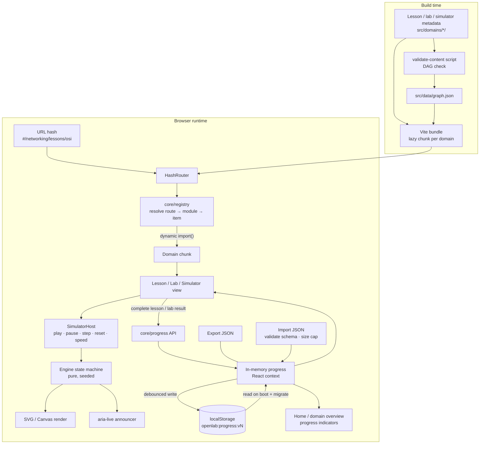

# Application Data Flow

All data flow is inside the browser. There are three kinds of data:

1. **Static content** — lessons, labs, simulator definitions, catalogue. Bundled at build time.
2. **Ephemeral UI/simulation state** — React state; lives for the page session.
3. **Persistent learner state** — progress and preferences; `localStorage`.

## End-to-end flow

## Flows in detail

### Navigation

1. Learner clicks a link or edits the hash.
2. `HashRouter` matches against the route table that `core/registry` generated from all
   `DomainModule` definitions at startup.
3. The matched route's domain chunk is `import()`ed lazily; a suspense fallback shows meanwhile.
4. The view receives the resolved `Lesson` / `Lab` / `Simulator` object as props.

### Simulation

1. `SimulatorHost` owns the control state (running, speed, step index) and the engine instance.
2. On each tick (`requestAnimationFrame` via `useAnimationFrame`) it calls `engine.step(state)`
   — a pure function — and stores the new state.
3. The view renders state to SVG or Canvas. It never mutates engine state directly.
4. State changes that matter to a learner are summarised to an `aria-live` region, throttled.
5. Labs add a `check(state): LabResult` function; a passing result is sent to `core/progress`.

### Progress

1. On boot, `core/progress` reads the namespaced key, validates and migrates the schema, and
   seeds the React context. Failure (corrupt / quota / unavailable) falls back to an empty
   in-memory store and the UI shows a non-blocking notice.
2. Components call `useProgress()` for reads and `markLessonComplete(id)` / `recordLabResult(...)`
   for writes. They never touch `localStorage`.
3. Writes update context immediately and persist with a debounce (~300 ms).
4. Export serialises the store to a JSON file download; import reads a file, validates it
   against the schema (unknown keys rejected, size-capped), then replaces or merges.

### Search (Phase 2)

A small index (title, tags, outcomes) is built at build time into `src/data` and queried
client-side with a simple scorer. No external search service.

## Data at rest

| Key                   | Content                                                                                                                                | Size budget |
| --------------------- | -------------------------------------------------------------------------------------------------------------------------------------- | ----------- |
| `openlab:progress:v1` | `{ schemaVersion, completedLessons: string[], labResults: Record<id, LabResult>, lastVisited, preferences: { theme, reducedMotion } }` | < 100 KB    |

Nothing else is written to the browser. No cookies.

## What never happens

- No network request after the static assets load (CSP `connect-src 'none'`).
- No data leaves the device unless the learner exports a file.
- No server-side state of any kind.
