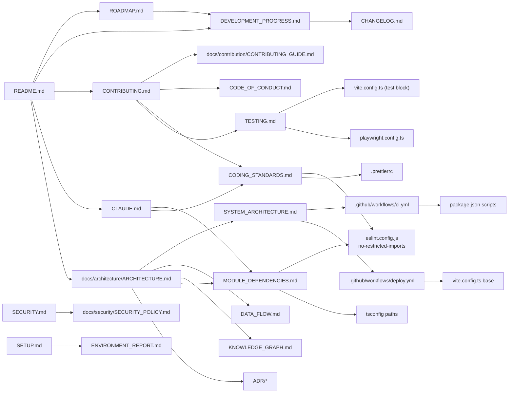
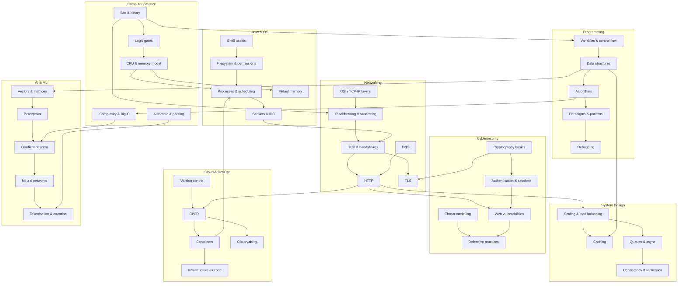

# Knowledge Graphs

Two graphs matter in OPENLAB:

1. The **project knowledge graph** — how the codebase, documents and processes relate. For contributors.
2. The **learning knowledge graph** — how concepts and lessons depend on each other across domains. For learners, and for the "learn next" engine.

## 1. Project knowledge graph



Reading guide: start at `README.md`; for rules go `CLAUDE.md` → `MODULE_DEPENDENCIES.md` →
`CODING_STANDARDS.md`; for design go `ARCHITECTURE.md` → the specific view → ADRs.

## 2. Learning knowledge graph

Each domain owns its lessons, but prerequisites cross domain boundaries freely. The graph below
is the **planned top-level concept map**; the real graph is derived at build time from each
lesson's `prerequisites` metadata and will be far more granular.



### How the graph is used

| Feature                                  | Uses                                                   |
| ---------------------------------------- | ------------------------------------------------------ |
| Lesson page "Before this" / "Learn next" | Direct prerequisite / dependent edges                  |
| Domain overview                          | Topological order of lessons within the domain         |
| Learning paths (Phase 6)                 | Shortest prerequisite closure to a target lesson       |
| Content validation script                | Detects cycles, dangling prerequisites, orphan lessons |

### Metadata contract (Phase 2)

```ts
interface LessonMeta {
  id: string; // 'networking/tcp-handshake'
  prerequisites: string[]; // ids, may cross domains
  outcomes: string[]; // "can explain …", "can configure …"
  estimatedMinutes: number;
  tags: string[];
}
```

The build-time script `scripts/validate-content.mjs` (Phase 2) turns all `LessonMeta` into a DAG,
fails CI on cycles, and emits `src/data/graph.json` consumed by the UI.
