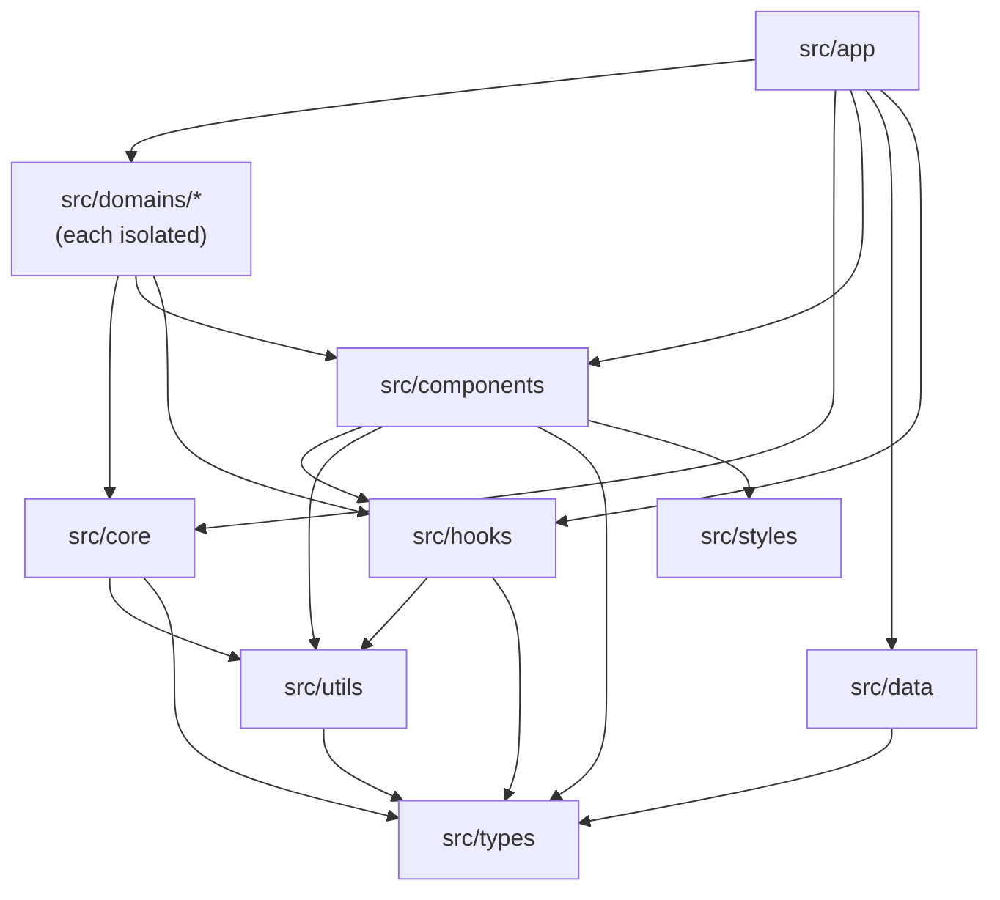
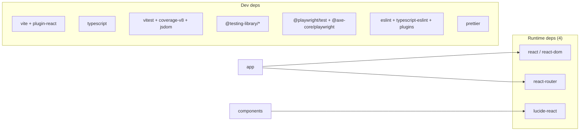

# Module Dependencies

The codebase is layered. Imports only point **downward**. The table and diagram are the
authoritative rules; ESLint enforces the domain-isolation part, code review enforces the rest.

## Allowed import directions

| Layer         | May import                                                        | Must NOT import                                       |
| ------------- | ----------------------------------------------------------------- | ----------------------------------------------------- |
| `app`         | everything below                                                  | —                                                     |
| `domains/<x>` | `core`, `components`, `hooks`, `utils`, `types`, `styles`, `data` | `app`, **any other domain**                           |
| `core`        | `utils`, `types`                                                  | `app`, `domains`, `components`, `hooks` (no React UI) |
| `components`  | `hooks`, `utils`, `types`, `styles`                               | `app`, `domains`, `core`*                             |
| `data`        | `types`                                                           | everything else                                       |
| `hooks`       | `utils`, `types`                                                  | `app`, `domains`, `components`, `core`*               |
| `utils`       | `types`                                                           | everything else                                       |
| `types`       | nothing                                                           | everything                                            |
| `styles`      | nothing (CSS only)                                                | —                                                     |

\* `components/learning/*` (LessonRenderer, SimulatorHost) are the one sanctioned exception: they
import **types** from `core/model`, never runtime code. Progress access from components goes
through the `useProgress` hook provided by `app` via context, so components stay unaware of
storage.

## Why

- **Domains isolated** → contributors work in parallel without merge conflicts; a domain can be
  removed or lazily loaded without touching anything else.
- **Core has no React** → engine logic is unit-testable in Node without jsdom, and could be reused
  in a worker (Phase 6).
- **Components know nothing about domains** → the UI vocabulary stays generic.

## Enforcement

- ESLint `no-restricted-imports` blocks `@domains/*` imports from inside another domain
  (see `eslint.config.js`). Importing `@domains/*` from `app` is allowed.
- tsconfig `paths` define the aliases; relative `../../` imports across layers are a review smell.
- A dependency-cruiser or custom script can be added in Phase 2 to enforce the full table in CI
  without adding a runtime dependency.

## Third-party dependency map

Runtime bundle depends on exactly three packages (React counts as one). All MIT/ISC licensed.
Adding a fourth needs an ADR.
