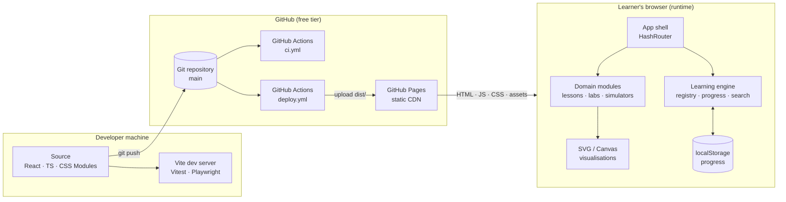
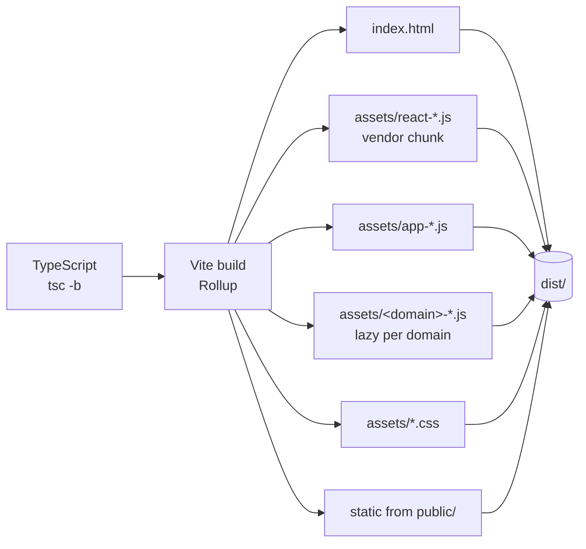
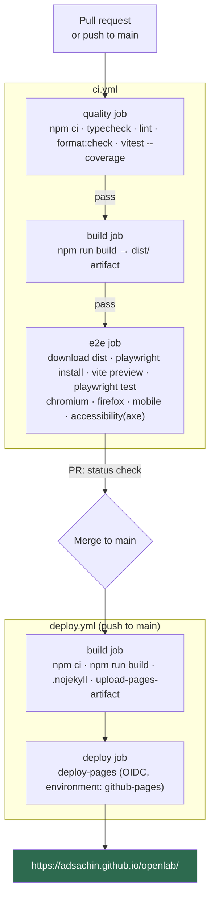

# System Architecture

## Overall system

There is exactly one runtime component: the learner's browser. Everything else is build-time
or hosting.

No arrows leave the browser after initial load. `connect-src 'none'` in the CSP makes that a
guarantee rather than a convention.

## Components

| Component         | Technology             | Responsibility                                              | Cost                       |
| ----------------- | ---------------------- | ----------------------------------------------------------- | -------------------------- |
| Source repository | GitHub (public)        | Version control, issues, PRs, Dependabot                    | Free                       |
| CI                | GitHub Actions         | Typecheck, lint, format, unit, build, e2e, a11y on every PR | Free (public repo minutes) |
| CD                | GitHub Actions → Pages | Build `dist/` and publish on push to `main`                 | Free                       |
| Hosting / CDN     | GitHub Pages           | Serve static files over HTTPS                               | Free                       |
| Runtime           | Browser                | Everything the learner experiences                          | Free                       |
| Persistence       | `localStorage`         | Progress and preferences                                    | Free                       |

Total recurring cost: **$0**.

## Build pipeline

Each domain is a lazy route chunk, so a learner studying networking never downloads the AI/ML
module.

## CI/CD deployment pipeline

Properties:

- `ci.yml` has `contents: read` only. Forked PRs get no write access (`pull_request` event).
- `deploy.yml` uses OIDC (`id-token: write`) and the `github-pages` environment; no stored secrets.
- `concurrency` cancels superseded CI runs but never cancels an in-flight deploy.
- Pages source must be set to **GitHub Actions** (not a branch) once, manually.

## Environments

| Environment   | URL                                   | Trigger                            |
| ------------- | ------------------------------------- | ---------------------------------- |
| Local dev     | `http://localhost:5173/openlab/`      | `npm run dev`                      |
| Local preview | `http://localhost:4173/openlab/`      | `npm run build && npm run preview` |
| CI preview    | ephemeral, inside the e2e job         | every PR                           |
| Production    | `https://adsachin.github.io/openlab/` | push to `main`                     |

There is no staging environment. PR previews can be added later with a free Pages-per-branch
pattern if ever needed; not planned.

## Failure modes

| Failure                  | Effect             | Mitigation                                                         |
| ------------------------ | ------------------ | ------------------------------------------------------------------ |
| GitHub Pages outage      | Site unavailable   | Nothing to do; `dist/` can be served from any static host          |
| Bad deploy               | Broken site        | Re-run `deploy.yml` from a known-good commit (`workflow_dispatch`) |
| localStorage unavailable | Progress not saved | Store degrades to in-memory; UI shows a notice                     |
| Large simulator too slow | Jank               | Canvas fallback, reduced-motion path, web worker (Phase 6)         |
