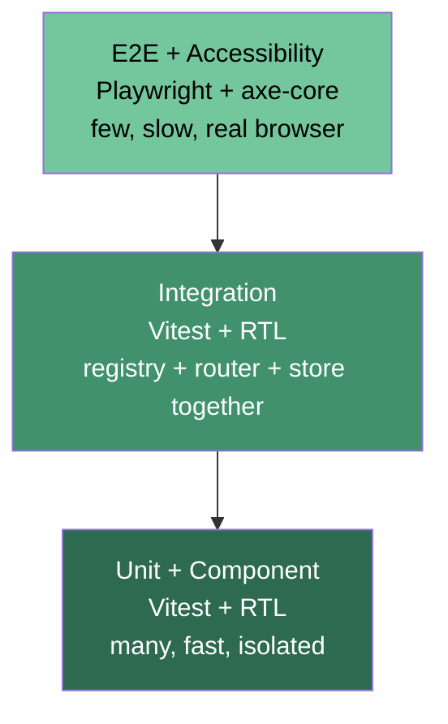

# Testing Strategy

Goal: confidence that lessons, labs and simulators behave correctly and remain accessible, with
fast feedback. Tests are a requirement for merging, not an afterthought.

## Test pyramid



| Layer         | Tool                                          | Location                          | Runs on                |
| ------------- | --------------------------------------------- | --------------------------------- | ---------------------- |
| Unit          | Vitest                                        | `src/**/*.test.ts`, `tests/unit/` | every PR, pre-push     |
| Component     | Vitest + React Testing Library + jsdom        | `src/**/*.test.tsx`               | every PR               |
| Integration   | Vitest + RTL                                  | `tests/integration/`              | every PR               |
| E2E           | Playwright (chromium, firefox, mobile-chrome) | `tests/e2e/`                      | every PR (after build) |
| Accessibility | Playwright + `@axe-core/playwright`           | `tests/accessibility/`            | every PR               |

## What to test at each layer

**Unit** — `src/core` (progress store schema migration, registry, search), `src/utils`
(every exported function), hooks (via `renderHook`). Simulation engines are tested here
with seeded inputs and exact expected states.

**Component** — rendering with props, user interaction via `@testing-library/user-event`,
accessible roles/names (`getByRole`), keyboard operation, reduced-motion behaviour.
Prefer queries by role and label; never by class name or test id unless unavoidable.

**Integration** — domain module registration produces the expected routes; completing a lesson
updates progress and the UI reflects it; import/export round-trips progress JSON.

**E2E** — a handful of critical journeys: load home → open a domain → open a lesson → run a
simulator → progress persists after reload. Keep under ~15 specs total; they are slow.

**Accessibility** — one spec per route pattern running axe with the `wcag2a`, `wcag2aa`,
`wcag22aa` tags. Zero violations is the bar. Manual screen-reader checks are still expected for new UI.

## Conventions

- Test file beside the subject for components/hooks; in `tests/` for cross-cutting tests.
- `describe('<Subject>')` → `it('does X when Y')`. Names are sentences.
- Arrange-Act-Assert, one behaviour per `it`.
- No snapshot tests of large DOM trees. Snapshot only small serialisable data (e.g. a route table).
- `localStorage` is cleared after each test by `tests/setup.ts`.
- Deterministic: mock `Date`, seed RNG, no real timers unless testing timing (`vi.useFakeTimers`).

## Coverage

Collected with `@vitest/coverage-v8` and uploaded in CI. Targets (not yet enforced; will be
turned into thresholds in Phase 2):

| Area             | Target                                       |
| ---------------- | -------------------------------------------- |
| `src/core`       | 90 % lines                                   |
| `src/utils`      | 95 % lines                                   |
| `src/components` | 80 % lines                                   |
| `src/domains`    | 70 % lines (simulators' engine logic ≥ 90 %) |

## Running

```bash
npm run test              # unit + integration, once
npm run test:watch        # watch mode
npm run test:coverage     # with coverage report in coverage/
npm run test:e2e          # Playwright, starts dev server automatically
npm run test:e2e:ui       # Playwright UI mode
npm run test:a11y         # accessibility project only
```

CI runs E2E against the production `dist/` via `vite preview` (see `.github/workflows/ci.yml`).

## Status (2026-11-15)

Phase 1 ships the first real tests, all passing locally:

| Suite                     | Count | Covers                                                                       |
| ------------------------- | ----- | ---------------------------------------------------------------------------- |
| Vitest unit               | 14    | safe localStorage wrapper, preferences schema/guards, domain catalogue, `cx` |
| Vitest component          | 7     | HomePage, DomainPage, full App (hash routing, 404, theme toggle persistence) |
| Playwright e2e (chromium) | 6     | load, navigation, deep link + reload, 404, theme persistence, skip link      |
| Playwright axe            | 6     | home, domain, 404 × light and dark, WCAG 2.x A/AA tags, zero violations      |

Firefox and mobile-chrome projects run in CI (only Chromium is installed locally).
